<div align="center">



<br/>

[](https://www.linkedin.com/in/rasittaflan)
[](https://github.com/rasittaflan)
[](https://www.ktu.edu.tr/eee)

<br/>

**[About](#1-professional-overview)** &nbsp;|&nbsp; **[Featured Projects](#2-featured-engineering-projects)** &nbsp;|&nbsp; **[Experience](#3-research--engineering-experience)** &nbsp;|&nbsp; **[Technical Competencies](#4-technical-competencies)** &nbsp;|&nbsp; **[Türkçe Profil (README_TR.md)](README_TR.md)**

</div>

---

<a id="about-me"></a>

## 1. Professional Overview

I am a 4th-year **Electrical & Electronics Engineering student** at **Karadeniz Technical University (KTU)** (*Expected Graduation: 2027*).

My engineering work focuses on solving physical engineering challenges through the integration of **numerical multiphysics modeling**, **power converter topologies**, and **embedded closed-loop control**. Rather than abstract software development, my research and technical projects center on:

* **Power Electronics & Conversion:** Switch-mode DC-DC converters (Buck, Boost, LLC Resonant, Phase-Shifted Full-Bridge ZVS, Vienna PFC), magnetics design, and semiconductor thermal/stress analysis.
* **Electromagnetic Simulation & FEA:** 2D and 3D magnetostatic finite element analysis using Ansys Maxwell and FEMM, focusing on air-gap magnetic flux density, B-H core saturation, and force generation.
* **Control Systems & Dynamics:** Non-linear plant modeling, discrete-time feedback control, and PID + Anti-Windup algorithms in MATLAB/Simulink.
* **Embedded Hardware & Firmware:** Bare-metal C development on ARM Cortex-M microcontrollers (**Nuvoton M032KG** and **STM32**), hardware timer PWM, ADC acquisition, and UART/CAN telemetry.

---

<a id="featured-engineering-projects"></a>

## 2. Featured Engineering Projects

All projects below include accessible repositories, simulation models, and verifiable analytical formulations.

---

### Project 1: Electromagnetic Levitation (Maglev) FEA & System Dynamics Suite
> **TÜBİTAK 2209-B Industry-Oriented Undergraduate Research Project**  
> *Karadeniz Technical University — Department of Electrical & Electronics Engineering*

* **Engineering Problem:** Contactless electromagnetic suspension for high-speed ground transport (Hyperloop) and industrial positioning is open-loop unstable according to Earnshaw's Theorem. Lifting force is non-linear and inversely proportional to the square of the air gap ($F \propto 1/g^2$), requiring coupled magnetic and dynamic control modeling.
* **Technical Approach:** Combined numerical finite element analysis (FEA) in **Ansys Maxwell 2D Axisymmetric** with closed-loop feedback control synthesis in **MATLAB/Simulink**.
* **Implementation:**
  * Modeled a cylindrical electromagnet with a Steel 1008 core ($r = 5\text{ mm}, L = 30\text{ mm}$) and a 500-turn copper coil ($d = 0.7\text{ mm}$).
  * Configured adaptive meshing with a 1.0% target error criterion in Ansys Maxwell Magnetostatic solver.
  * Formulated non-linear plant dynamics in MATLAB/Simulink; designed a discrete-time PID + Anti-Windup position regulator with simulated thermal limits.
* **Results & Validation Status:**
  * *FEA Simulation Result (V1 Actuator):* Ansys Maxwell 2D magnetostatic analysis calculated a static lifting force of **$F_z = 22.26\text{ mN}$ at $1.0\text{ A}$** and **$F_z \approx 0.482\text{ N}$ at $4.8\text{ A}$** across a **$5.0\text{ mm}$ air gap**.
  * *Dynamic Simulation Status:* Closed-loop stability and disturbance rejection verified via 300-second non-linear Simulink simulations.
  * *Design Target:* Multi-actuator distributed pod suspension target set at $\ge 130\text{ N}$ for V2 development.
* 📂 **Repository:** [`rasittaflan/Electromagnetic-Levitation-FEA-Simulations`](https://github.com/rasittaflan/Electromagnetic-Levitation-FEA-Simulations)
* 🚀 **Interactive Demo:** [Launch 3D WebGL Maglev Digital Twin](https://rasittaflan.github.io/Electromagnetic-Levitation-FEA-Simulations/) | [Live Force Calculator](https://rasittaflan.github.io/Electromagnetic-Levitation-FEA-Simulations/Maglev_Canli_Hesaplayici.html)

---

### Project 2: Power Electronics — 16 SMPS Topologies Design & Live Formula Suite
> **Engineering Calculation Engine based on Texas Instruments Standards (SLYU036A & SLYW038B)**

* **Engineering Problem:** Evaluating switch-mode DC-DC converters across diverse voltage ratios requires comparing 16 isolated and non-isolated topologies under continuous/discontinuous conduction mode (CCM/DCM), semiconductor stress, and duty cycle boundaries.
* **Technical Approach:** Created an interactive engineering design suite that provides cross-verification between mathematical spreadsheet workbooks (`.xlsx` & `.ods`) and zero-dependency browser-based analytical calculation engines.
* **Implementation:**
  * Analyzed 16 topologies: Buck, Boost, Inverting Buck-Boost, SEPIC, Ćuk, Zeta, Flyback, Two-Switch Flyback, Active Clamp Forward, Single-Switch Forward, Two-Switch Forward, Push-Pull, Weinberg, Half-Bridge, Full-Bridge, and Phase-Shifted Full-Bridge (PSFB - ZVS).
  * Formulated a calculation pipeline mapping 14 user design input parameters to 25 continuous output variables per converter.
* **Results & Validation Status:**
  * *Analytical Parity:* Formulated and cross-verified **400 active engineering equations** with 1:1 parity between Excel/Calc models and the JavaScript calculation engine.
  * *Model-Based Calculations:* Accurately computes inductor ripple current ($\Delta I_L$), capacitor ripple voltage ($\Delta V_{out}$), semiconductor peak stress, and Zero-Voltage Switching (ZVS) transition conditions.
* 📂 **Repository:** [`rasittaflan/Power_Electronics`](https://github.com/rasittaflan/Power_Electronics)
* 🚀 **Interactive Demo:** [Launch Live SMPS Calculator](https://raw.githack.com/rasittaflan/Power_Electronics/main/TI_16_Canli_Hesaplayici.html) | [LaTeX / MathML Reference Table](https://raw.githack.com/rasittaflan/Power_Electronics/main/TI_16_Guc_Kaynagi_Topolojisi_Interaktif_Tablo.html)

---

### Project 3: Bodrum Gulet Hybrid EMS — Renewable Power & Naval Stability Optimization
> **KTÜ MHN 4001 Interdisciplinary Engineering Capstone Project**  
> *Authors: Muhammet Raşit Taflan & Muhammed Emin Kadirov*

* **Engineering Problem:** Traditional wooden charter gulets (20–35 m) continuously run auxiliary diesel alternator sets 24 hours/day to sustain hotel electrical loads while anchored, causing fuel waste, acoustic noise, and coastal marine emissions.
* **Technical Approach:** Modeled and simulated a marine microgrid coupling solar PV, LiFePO4 battery storage, and auxiliary diesel generation, governed by a rule-based discrete Energy Management System (EMS) while evaluating naval transverse intact stability.
* **Implementation:**
  * Implemented a discrete-time Finite State Machine (FSM) enforcing Kirchhoff power balance across a 48 VDC bus ($\Delta t = 5\text{ min}$, balance tolerance $|P_{balance}| < 10^{-9}\text{ kW}$).
  * Coupled astronomical solar trajectory modeling for Bodrum coordinates ($37.034^\circ\text{ N}, 27.430^\circ\text{ E}$) to compare **Model A (8.0 kWp Fixed Bimini)** vs. **Model B (13.6 kWp Retractable Solar Wings)** under wind-speed safety constraints.
* **Results & Validation Status:**
  * *Simulation Estimate:* Daily diesel fuel consumption reduced by **71.6%** (from $88.42\text{ L/day}$ baseline to $25.10\text{ L/day}$ in Model B).
  * *Operational Estimate:* Daily auxiliary generator runtime reduced from 24.0 h to 6.4 h, enabling **17.6 hours of continuous silent operation** daily.
  * *Analytical Projection:* Estimated **20.36 tons of seasonal $\mathrm{CO}_2$ avoided** over a 120-day charter season.
  * *Preliminary Hydrostatics:* Calculated transverse metacentric height ($GM = 1.021\text{ m}$, $\Delta KG = +9.4\text{ mm}$), confirming form stability.
* 📂 **Repository:** [`rasittaflan/Bodrum-Gulet-Hybrid-EMS-Simulator`](https://github.com/rasittaflan/Bodrum-Gulet-Hybrid-EMS-Simulator)
* 🚀 **Interactive Demo:** [Launch 3D WebGL Marine EMS Simulator](https://rasittaflan.github.io/Bodrum-Gulet-Hybrid-EMS-Simulator/)

---

<a id="experience"></a>

## 3. Research & Engineering Experience

### ⚡ Vestel R&D — Hardware Design Engineering Intern
**Electric Vehicle Charging Systems** • *Summer 2026 (6-Week Hardware R&D Internship)*  
* Investigated power converter topologies for EV charging stations, focusing on isolated DC-DC stages including **LLC Resonant Converters** and Zero-Voltage Switching (ZVS) **Phase-Shifted Full-Bridge (PSFB)**.
* Evaluated three-phase **Vienna PFC** rectifiers and **interleaved boost** stages for power factor correction and harmonic mitigation.
* Participated in semiconductor loss calculations, capacitor ripple budgeting, thermal validation, and CAN bus telemetry diagnostics in high-power test laboratories.

---

### 🧲 TÜBİTAK 2209-B — Undergraduate Research Project
**Electromagnetic Levitation & Control** • *Karadeniz Technical University*  
* *Project Title:* "Design of PID Controlled Electromagnetic Levitation System and Its Integration into Hyperloop Applications".
* Conducted 2D magnetostatic finite element analysis, air-gap flux calculations, and coil thermal dissipation modeling.
* Synthesized discrete-time closed-loop feedback algorithms coupling Maxwell FEA data with Simulink dynamic plant models.

---

### 🏎️ Ege University Electric Vehicle Team — Former Team Captain
**Electric Competition Vehicle Engineering** • *August 2023 – September 2024*  
* Led the multidisciplinary student engineering team through design, component integration, low-voltage wiring harness assembly, and track testing for an energy-efficient electric competition vehicle.
* Supervised Battery Management System (BMS) cell monitoring, high-voltage safety interlocks, motor controller parameter tuning, and CAN telemetry.
* Ensured technical compliance with competition electrical safety regulations.

---

### 🚝 Hyperloop Team Engineering
**Levitation & Dynamics Subsystems**  
* Contributed to engineering studies on electromagnetic levitation actuators, linear induction propulsion concepts, power distribution, and dynamic stability.

---

<a id="technical-competencies"></a>

## 4. Technical Competencies

The skills listed below represent tools, methods, and hardware used directly in research projects, laboratory testing, and engineering coursework:

| Competency Domain | Core Tools & Frameworks | Practical Engineering Application |
| :--- | :--- | :--- |
| **Power Electronics** | DC-DC Converters, LLC Resonant, PSFB (ZVS), Vienna PFC, Buck/Boost Topologies | Converter design, magnetic core/inductor calculations, semiconductor stress and thermal loss analysis. |
| **Control & Simulation** | MATLAB, Simulink, Simscape, State-Space, Classical Control | Non-linear dynamic plant modeling, discrete-time PID + Anti-Windup control, stability verification. |
| **Electromagnetics & FEA** | Ansys Maxwell 2D, FEMM 4.2 | 2D magnetostatic field analysis, B-H core saturation modeling, coil inductance calculation, air-gap force mapping. |
| **Embedded Systems** | **Nuvoton M032KG** (ARM Cortex-M0), **STM32** (ARM Cortex-M), C, GCC, VS Code, Nu-Link, STM32CubeIDE | Bare-metal firmware development, hardware timer PWM generation, multi-channel ADC acquisition, UART communication, CAN bus. |
| **Engineering Software** | Python (NumPy / SciPy), JavaScript, HTML5 / MathML, LaTeX, Git, GitHub | Discrete numerical modeling, interactive calculation engines, version control, technical documentation. |
| **Laboratory Instrumentation** | Digital Storage Oscilloscopes, Power Analyzers, Electronic Loads, LCR Meters | Power stage waveform debugging, current ripple measurement, thermal testing, bench validation. |

---

<a id="education"></a>

## 5. Education & Academic Background

* **Bachelor of Science in Electrical & Electronics Engineering**  
  **Karadeniz Technical University (KTU)**, Trabzon, Türkiye  
  *Status:* 4th-Year Undergraduate Student &nbsp;|&nbsp; *Expected Graduation:* **2027**  
  *Relevant Coursework:* Power Electronics, Control Systems, Electromagnetic Field Theory, Microprocessors, Electrical Machines, Signals & Systems.

---

<a id="turkce-profil"></a>

## 6. 🇹🇷 Türkçe Profil Özeti

> [!NOTE]
> Tam kapsamlı, bağımsız Türkçe portföy dokümanı için [**👉 README_TR.md**](README_TR.md) dosyasını inceleyebilirsiniz.

**Muhammet Raşit Taflan**, Karadeniz Teknik Üniversitesi (KTÜ) Elektrik-Elektronik Mühendisliği 4. sınıf lisans öğrencisidir (*Beklenen Mezuniyet: 2027*).

Çalışmaları yazılım geliştirmeden ziyade **güç elektroniği**, **sonlu elemanlar analizi (FEA)**, **gömülü sistemler (Nuvoton M032 / STM32)** ve **kapalı çevrim kontrol dinamikleri** alanlarında gerçek fiziksel mühendislik problemlerine yönelik tasarım, analiz, simülasyon ve Ar-Ge faaliyetlerine odaklanmaktadır.

* **Öne Çıkan Çalışmalar:** TÜBİTAK 2209-B Elektromanyetik Levitasyon FEA simülasyonları ($F_z = 22.26\text{ mN}$ @ $1\text{ A}$ Ansys Maxwell 2D magnetostatik hesabı), TI standartlarında 16 SMPS Güç Elektroniği Tasarım Paketi (400 doğrulanmış denklem) ve Bodrum Guletleri için Hibrit Akıllı EMS Simülatörü (%71.6 simüle yakıt tasarrufu).
* **Deneyimler:** Vestel Ar-Ge Donanım Tasarımı Stajı (2026 Yazı, 6 Hafta), Ege Üniversitesi Elektrikli Araç Takım Kaptanlığı (Ağustos 2023 – Eylül 2024), Hyperloop takımı alt sistem çalışmaları.

---

<a id="contact"></a>

## 7. Contact & Professional Links

<div align="center">

[](https://www.linkedin.com/in/rasittaflan)
[](https://github.com/rasittaflan)

<br/>

```
Muhammet Raşit Taflan
Department of Electrical & Electronics Engineering
Karadeniz Technical University (KTU) | Trabzon, Türkiye
LinkedIn: https://www.linkedin.com/in/rasittaflan
GitHub:   https://github.com/rasittaflan
```

---

*Disciplined engineering analysis, physical simulation, and research-driven hardware design ⚡*

</div>
