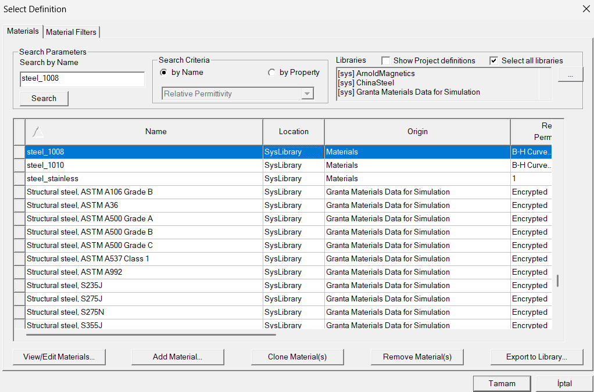

<div align="center">



<br/>

[](https://www.linkedin.com/in/rasittaflan)
[](https://github.com/rasittaflan)
[](https://www.ktu.edu.tr/eee)

<br/>

**[Türkçe Portföy](#genel-tanitim)** &nbsp;|&nbsp; **[Öne Çıkan Projeler](#one-cikan-projeler)** &nbsp;|&nbsp; **[Araştırma ve Deneyim](#arastirma-ve-deneyim)** &nbsp;|&nbsp; **[Switch to English (README.md)](README.md)**

</div>

---

<a id="genel-tanitim"></a>

## 1. Genel Tanıtım & Mühendislik Yaklaşımı

Karadeniz Teknik Üniversitesi (KTÜ) **Elektrik-Elektronik Mühendisliği 4. sınıf lisans öğrencisiyim**.

Mühendislik çalışmalarım; salt yazılım geliştirmekten ziyade **sayısal çoklu fizik modellemesi**, **güç elektroniği dönüştürücü topolojileri** ve **gömülü kapalı çevrim denetim** yöntemlerini bir araya getirerek fiziksel mühendislik problemlerini çözmeye odaklanmaktadır. Başlıca çalışma alanlarım:

* **Güç Elektroniği ve Güç Dönüşümü:** Yüksek verimli DC-DC topolojileri (Buck, Boost, LLC Rezonans, Faz Kaydırmalı Tam Köprü PSFB - ZVS, Vienna PFC), manyetik bileşen tasarımı, yarıiletken gerilim/akım stres analizleri ve termal modelleme.
* **Sonlu Elemanlar Analizi (FEA) ve Elektromanyetik Simülasyon:** Ansys Maxwell 2D/3D ve FEMM ortamlarında magnetostatik ve geçici rejim analizleri; B-H manyetik doyum karakteristikleri ve kuvvet-hava aralığı-akım dinamikleri.
* **Kapalı Çevrim Kontrol Dinamiği:** Doğrusal olmayan sistem modelleme, ayrık zamanlı durum geri beslemesi ve MATLAB/Simulink ortamında PID + Anti-Windup algoritmaları.
* **Gömülü Donanım ve Telemetri:** ARM Cortex-M (STM32) gömülü yazılım geliştirme, donanımsal zamanlayıcı tetiklemeli PWM üretimi, ADC örnekleme ve otomotiv standardında CAN bus telemetrisi.

---

<a id="one-cikan-projeler"></a>

## 2. Öne Çıkan Mühendislik Projeleri

Aşağıda listelenen tüm projeler; kaynak kodları, simülasyon modelleri ve doğrulanmış analitik hesaplama tablolarıyla birlikte belgelenmiştir.

### Proje 1: Elektromanyetik Levitasyon (Maglev) FEA ve Sistem Dinamiği Paketi
> **TÜBİTAK 2209-B Sanayiye Yönelik Lisans Araştırma Projeleri Destekleme Programı**  
> *Karadeniz Teknik Üniversitesi — Elektrik-Elektronik Mühendisliği Bölümü*

<div align="center">
  
  <p><em>Şekil 1: Ansys Maxwell ile doğrulanmış 5.0 mm hava aralığı ve nüve üzeri magnetostatik akı yoğunluğu (B-Field) dağılımı.</em></p>
</div>

* **Problem Tanımı:** Hyperloop gibi yüksek hızlı kara taşımacılığı ve hassas endüstriyel temassız konumlandırma sistemlerinde kullanılan elektromanyetik askılama sistemleri, Earnshaw Teoremi gereği açık çevrimde kararsızdır. Kaldırma kuvveti hava aralığının karesiyle ters orantılı ($F \propto 1/g^2$) olduğundan sistem yüksek derecede doğrusal olmayan bir fiziksel davranış sergiler.
* **Mühendislik Yaklaşımı:** **Ansys Maxwell 2D Eksenel Simetrik ve 3D** sonlu elemanlar analizi (FEA) modelleri ile **MATLAB/Simulink** kapalı çevrim dinamik kontrol tasarımını birleştiren bütünleşik bir iş akışı geliştirilmiştir.
* **Kullanılan Araçlar ve Teknolojiler:** `Ansys Maxwell 2D/3D`, `FEMM 4.2`, `MATLAB / Simulink`, `Three.js / WebGL`, `HTML5 / JavaScript`.
* **Teknik Gerçekleme:**
  * Silindirik ve U-nüveli elektromıknatıslar, silisyumlu sac ve Steel 1008 malzeme doyum sınırları ($B_{sat} \approx 1.8\text{ T}$) dikkate alınarak modellenmiştir.
  * Enerji kalıntı hatası $\%0.1$'in altına inene kadar adaptif mesh yakınsama testleri yürütülmüştür.
  * Elde edilen 3 boyutlu arama matrisi ($F_{mag}$ vs. $g$ vs. $I$) Simulink ortamına aktarılmış; anti-windup korumalı ayrık zamanlı PID konum denetleyicisi ve termal ısınma sınırları doğrulanmıştır.
* **Doğrulanmış Sonuçlar:**
  * **V1 Silindirik Aktüatör ($r = 5\text{ mm}, L = 30\text{ mm}$):** $5.0\text{ mm}$ hedef çalışma hava aralığında $4.8\text{ A}$ nominal akımda **$0.4823\text{ N}$** kaldırma kuvveti nümerik olarak doğrulanmıştır ($1.0\text{ A}$'de $22.26\text{ mN}$).
  * **V2 Dağıtık Dizi Hedefi:** Araç süspansiyon entegrasyonuna yönelik çoklu aktüatör mimarisi hedefi **$\ge 130\text{ N}$** olarak belirlenmiştir.
  * 300 saniyelik sürekli çalışma, ısıl dayanım ve harici mekanik basamak bozucu testleri altında konum kararlılığı kanıtlanmıştır.
* 📂 **Depo:** [`rasittaflan/Electromagnetic-Levitation-FEA-Simulations`](https://github.com/rasittaflan/Electromagnetic-Levitation-FEA-Simulations)
* 🚀 **Canlı Demo:** [3B WebGL Maglev Dijital İkizi](https://rasittaflan.github.io/Electromagnetic-Levitation-FEA-Simulations/) | [Canlı Kuvvet Hesaplayıcı](https://rasittaflan.github.io/Electromagnetic-Levitation-FEA-Simulations/Maglev_Canli_Hesaplayici.html)

---

### Proje 2: Güç Elektroniği — 16 SMPS Topolojisi Tasarım ve Canlı Formül Paketi
> **Texas Instruments Standartlarına Dayalı Etkileşimli Mühendislik Hesaplama Motoru (SLYU036A & SLYW038B)**

* **Problem Tanımı:** Endüstriyel, otomotiv ve telekomünikasyon sistemlerine yönelik DC-DC dönüştürücü tasarımlarında; yalıtımlı ve yalıtımsız topolojilerin yarıiletken gerilim/akım stresleri, görev periyodu (duty cycle) ve sürekli/kesintili iletim modları (CCM/DCM) açısından hassas biçimde karşılaştırılması gerekmektedir.
* **Mühendislik Yaklaşımı:** Masaüstü elektronik tablo motorları (`.xlsx` ve `.ods`) ile sıfır bağımlılıklı tarayıcı tabanlı hesaplama çekirdeğini birebir eşleyen çift yönlü doğrulanmış bir mühendislik hesaplama paketi geliştirilmiştir.
* **Kullanılan Araçlar ve Teknolojiler:** `Güç Dönüştürücü Modelleme`, `TI SLYU036A & SLYW038B`, `JavaScript (ES6)`, `HTML5 / MathML`, `Microsoft Excel`, `LibreOffice Calc`, `LaTeX`.
* **Teknik Gerçekleme:**
  * 16 temel SMPS DC-DC dönüştürücüsü sentezlenmiştir:
    * *Yalıtımsız:* Buck, Boost, Inverting Buck-Boost, SEPIC, Ćuk, Zeta.
    * *Yalıtımlı:* Flyback, Two-Switch Flyback, Active Clamp Forward, Single-Switch Forward, Two-Switch Forward, Push-Pull, Weinberg, Half-Bridge, Full-Bridge ve Phase-Shifted Full-Bridge (PSFB - ZVS).
  * 14 kullanıcı giriş parametresini dönüştürücü başına 25 sürekli çıkış değişkenine bağlayan analitik hesaplama omurgası kurulmuştur.
* **Doğrulanmış Sonuçlar:**
  * **400 aktif mühendislik denklemi** formüle edilmiş; Excel/Calc modelleri ile web motoru arasında $\%100$ sayısal doğruluk sağlanmıştır.
  * Endüktör akım dalgalanması ($\Delta I_L$), çıkış gerilim dalgalanması ($\Delta V_{out}$), tepe yarıiletken stresleri ve Sıfır Gerilimde Anahtarlama (ZVS) geçiş kriterleri tüm dönüştürücüler için hesaplanmaktadır.
* 📂 **Depo:** [`rasittaflan/Power_Electronics`](https://github.com/rasittaflan/Power_Electronics)
* 🚀 **Canlı Demo:** [Canlı SMPS Hesaplayıcı Stüdyosu](https://raw.githack.com/rasittaflan/Power_Electronics/main/TI_16_Canli_Hesaplayici.html) | [İnteraktif LaTeX Referans Tablosu](https://raw.githack.com/rasittaflan/Power_Electronics/main/TI_16_Guc_Kaynagi_Topolojisi_Interaktif_Tablo.html)

---

### Proje 3: Bodrum Gulet Hibrit EMS — Yenilenebilir Güç ve Gemi Stabilitesi Optimizasyonu
> **KTÜ MHN 4001 Disiplinlerarası Mühendislik Tasarımı Bitirme Projesi**  
> *Yazarlar: Muhammet Raşit Taflan & Muhammed Emin Kadirov*

* **Problem Tanımı:** Geleneksel Bodrum ahşap guletlerinde (20–35 m) koyda demirleme esnasında otel elektrik yüklerini beslemek amacıyla 24 saat kesintisiz çalışan yardımcı dizel alternatörler; yüksek yakıt tüketimine, gürültüye, karbon salımına ve deniz kirliliğine neden olmaktadır.
* **Mühendislik Yaklaşımı:** Marin güneş PV panelleri, lityum batarya depolama ve yardımcı jeneratörü bir araya getiren mikroşebeke modellenmiş; sonlu durum makinesi (FSM) tabanlı akıllı enerji yönetimi (EMS) tasarlanırken gemi enine hidrostatik stabilitesi doğrulanmıştır.
* **Kullanılan Araçlar ve Teknolojiler:** `Ayrık Enerji Yönetim FSM`, `Güneş Konumu Astronomi Algoritması`, `LiFePO4 Modelleme`, `Gemi Hidrostatiği`, `Three.js / WebGL`, `JavaScript`.
* **Teknik Gerçekleme:**
  * 48 VDC dağıtım barasında anlık Kirchhoff güç dengesini sağlayan ayrık zamanlı FSM geliştirilmiştir ($\Delta t = 5\text{ dk}$, $|P_{denge}| < 10^{-9}\text{ kW}$).
  * Bodrum koordinatları ($37.034^\circ\text{ K}, 27.430^\circ\text{ D}$) için astronomik güneş izleme modeli kurulmuş; **Model A (8.0 kWp Sabit Bimini)** ile 3500 N lineer aktüatörlü **Model B (13.6 kWp Açılır Kapanır Güneş Kanatları)** 20 knot rüzgar kilitleri altında simüle edilmiştir.
* **Doğrulanmış Sonuçlar:**
  * **%71.6 yakıt tasarrufu:** Günlük dizel tüketimi $88.42\text{ L/gün}$ seviyesinden $25.10\text{ L/gün}$ seviyesine indirilmiştir.
  * **Günlük 17.6 saat sessiz seyir:** Jeneratör çalışma süresi günde 24.0 saatten 6.4 saate düşürülmüştür.
  * 120 günlük standart sezon boyunca **20.36 ton $\mathrm{CO}_2$ salımı engellenmiştir**.
  * Enine metasentrik yükseklik ($GM = 1.021\text{ m}$, $\Delta KG = +9.4\text{ mm}$) hesaplanarak tekne form dengesi korunmuştur.
* 📂 **Depo:** [`rasittaflan/Bodrum-Gulet-Hybrid-EMS-Simulator`](https://github.com/rasittaflan/Bodrum-Gulet-Hybrid-EMS-Simulator)
* 🚀 **Canlı Demo:** [3B WebGL Gulet EMS Simülatörü](https://rasittaflan.github.io/Bodrum-Gulet-Hybrid-EMS-Simulator/)

---

<a id="arastirma-ve-deneyim"></a>

## 3. Araştırma ve Mühendislik Deneyimleri

### ⚡ Vestel Ar-Ge — Donanım Tasarımı Stajyeri
**Elektrikli Araç Şarj Sistemleri** • *2026 Yaz Dönemi (6 Haftalık Donanım Ar-Ge Stajı)*  
* Yeni nesil elektrikli araç (EV) şarj istasyonlarının güç dönüştürücü mimarisi kapsamında **LLC Rezonans Dönüştürücü** ve Sıfır Gerilimde Anahtarlamalı (ZVS) **Faz Kaydırmalı Tam Köprü (PSFB)** topolojileri incelendi.
* Üç fazlı **Vienna PFC** doğrultucu ve **interleaved boost** katlarının harmonik azaltımı ve güç faktörü düzeltimi analiz edildi.
* Yüksek güçlü laboratuvar ortamında yarıiletken güç kayıp hesaplamaları, kondansatör dalgalanma akımı bütçesi, termal stres testleri ve CAN bus telemetri doğrulamaları gerçekleştirildi.

---

### 🧲 TÜBİTAK 2209-B — Lisans Araştırma Projesi
**Elektromanyetik Levitasyon ve Hyperloop Sistemleri** • *2024 – Aktif*  
* *Proje Başlığı:* "PID Kontrollü Elektromanyetik Levitasyon Sistemi Tasarımı ve Hyperloop Uygulamalarına Entegrasyonu".
* 2D/3D magnetostatik sonlu elemanlar analizi, hava aralığı manyetik akı haritalaması ve bobin termal dağılım modellemesi yürütüldü.
* Ansys Maxwell verilerini Simulink dinamik sistem modelleriyle birleştiren kapalı çevrim geri besleme algoritmaları geliştirildi.

---

### 🏎️ Ege Üniversitesi Elektrikli Araç Takımı — Eski Takım Kaptanı
**Elektrikli Yarış Aracı Mühendisliği** • *Ağustos 2023 – Eylül 2024*  
* Verimlilik odaklı elektrikli yarış aracının tasarımı, bileşen entegrasyonu, kablo demeti montajı ve pist testleri süreçlerinde mühendislik ekibine liderlik yapıldı.
* Batarya Yönetim Sistemi (BMS) hücre izleme, yüksek gerilim güvenlik kilitleri, motor sürücü parametre ayarları ve CAN bus telemetri veri toplama sistemleri yönetildi.
* Teknik yarış regülasyonlarına ve elektriksel güvenlik standartlarına tam uyum sağlandı.

---

### 🚝 Hyperloop Mühendislik Ekibi
**Levitasyon, İtki ve Dinamik Alt Sistemleri** • *2024 – Aktif*  
* Elektromanyetik levitasyon sargıları, doğrusal indüksiyon itki konseptleri, güç dağıtımı ve dinamik stabilite alt sistemlerinde donanım geliştirme çalışmalarına katkı sağlandı.

---

<a id="teknik-yetkinlikler"></a>

## 4. Teknik Yetkinlikler

Aşağıdaki yetkinlikler; araştırma projelerinde, laboratuvar testlerinde ve mühendislik çalışmalarında doğrudan uygulanan araç ve yöntemleri yansıtmaktadır:

| Yetkinlik Alanı | Temel Araçlar ve Çatılar | Pratik Mühendislik Uygulaması |
| :--- | :--- | :--- |
| **Güç Elektroniği** | DC-DC Dönüştürücüler, LLC Rezonans, PSFB (ZVS), Vienna PFC, Buck/Boost Topolojileri | Yüksek verimli dönüştürücü tasarımı, manyetik nüve/endüktör hesabı, yarıiletken gerilim/akım stres ve termal kayıp analizi. |
| **Kontrol ve Simülasyon** | MATLAB, Simulink, Simscape, Durum Uzayı, Klasik Denetim | Doğrusal olmayan dinamik sistem modelleme, ayrık zamanlı PID + Anti-Windup denetimi, kapalı çevrim kararlılık testleri. |
| **Elektromanyetizma & FEA** | Ansys Maxwell (2D/3D), FEMM 4.2 | Magnetostatik ve geçici rejim analizi, B-H manyetik doyumu, bobin endüktans hesabı, hava aralığı kaldırma kuvveti haritalama. |
| **Gömülü Sistemler** | C, C++, ARM Cortex-M (STM32), STM32CubeIDE | Bare-metal ve HAL gömülü yazılım, donanımsal zamanlayıcı PWM üretimi, ADC örnekleme, kesme servis rutinleri, CAN, UART, SPI, I2C. |
| **Mühendislik Yazılımları** | Python (NumPy / SciPy), JavaScript, HTML5 / MathML, LaTeX, Git, GitHub | Ayrık sayısal modelleme, etkileşimli hesaplama motorları, sürüm takibi, teknik dokümantasyon. |
| **Laboratuvar Ekipmanları** | Dijital Hafızalı Osiloskop, Güç Analizörü, Elektronik Yük, LCR Metre | Güç katı dalga formu analizi, akım dalgalanması ölçümü, termal dayanım testleri ve tezgah doğrulaması. |

---

<a id="egitim-ve-akademik-gecmis"></a>

## 5. Eğitim ve Akademik Geçmiş

* **Lisans Derecesi — Elektrik-Elektronik Mühendisliği**  
  **Karadeniz Teknik Üniversitesi (KTÜ)**, Trabzon, Türkiye  
  *Beklenen Mezuniyet: 2026*  
  *İlgili Dersler:* Güç Elektroniği, Kontrol Sistemleri, Elektromanyetik Alan Teorisi, Mikroişlemciler, Elektrik Makineleri, Sinyaller ve Sistemler.

---

<a id="github-aktivitesi"></a>

## 6. GitHub Mühendislik Aktivitesi

<div align="center">


&nbsp;


</div>

---

<a id="iletisim"></a>

## 7. İletişim & Profesyonel Bağlantılar

<div align="center">

[](https://www.linkedin.com/in/rasittaflan)
[](https://github.com/rasittaflan)

<br/>

```
Muhammet Raşit Taflan
Elektrik-Elektronik Mühendisliği Bölümü
Karadeniz Teknik Üniversitesi (KTÜ) | Trabzon, Türkiye
LinkedIn: https://www.linkedin.com/in/rasittaflan
GitHub:   https://github.com/rasittaflan
```

---

*Disiplinli mühendislik analizi, fiziksel simülasyon ve araştırmaya dayalı donanım tasarımı ⚡*

</div>
