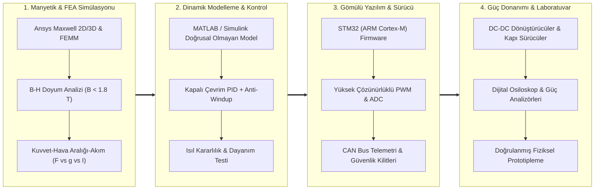

<div align="center">


<br/>

[](https://www.linkedin.com/in/rasittaflan)
[](https://github.com/rasittaflan)
[](https://www.ktu.edu.tr/eee)
[](#)

<br/>

### 🚀 Projelere Doğrudan Geçiş / Quick Project Access
[](#projeler)
[](#maglev-proje)
[](#guc-elektronigi-proje)
[](#gulet-ems-proje)

<br/>

### 🌐 Dil Seçeneği / Language Switch
[](README_TR.md)
[](README.md)

</div>

---

<a id="hakkimda"></a>

## 📌 Yönetici Özeti & Mühendislik Yaklaşımı

> **Muhammet Raşit Taflan**, Karadeniz Teknik Üniversitesi (KTÜ) Elektrik-Elektronik Mühendisliği 4. sınıf lisans öğrencisi ve Ar-Ge araştırmacısıdır.
> 
> Mühendislik metodolojisi; **sonlu elemanlar analizi (FEA)** ve **sayısal çoklu fizik simülasyonlarını** (Ansys Maxwell 2D/3D, MATLAB/Simulink), **fiziksel güç dönüştürücü donanım tasarımı**, **gömülü sistem denetimi (STM32 / C-C++)** ve **laboratuvar doğrulaması** ile birleştirmeye dayanır.
> 
> Başlıca uzmanlık alanları: **Anahtarlamalı Güç Kaynağı (SMPS) Topolojileri (LLC, PSFB, Vienna PFC)**, **Elektromanyetik Levitasyon (Maglev) ve FEA Analizleri**, **Kapalı Çevrim PID Kontrolü** ve **Yenilenebilir Hibrit Enerji Yönetim Sistemleri (EMS)**.

---

## 🧭 Çoklu Fizik ve Donanım Mühendisliği İş Akışı



---

<a id="deneyim"></a>

## 💼 Mühendislik ve Liderlik Deneyimleri

### ⚡ Donanım Ar-Ge Stajyeri — Elektrikli Araç Şarj Sistemleri
**Vestel Ar-Ge** • *2026 Yaz Dönemi (6 Haftalık Yoğun Donanım Ar-Ge Stajı)*  
* **Güç Dönüştürücü Topolojileri:** Yeni nesil elektrikli araç (EV) şarj istasyonlarının güç dönüştürücü mimarisi kapsamında **LLC Rezonans Dönüştürücü** ve Sıfır Gerilimde Anahtarlamalı (ZVS) **Faz Kaydırmalı Tam Köprü (PSFB)** topolojileri, 3 fazlı **Vienna PFC** doğrultucular ve **interleaved boost** giriş katları incelendi.
* **Laboratuvar & Doğrulama:** Yarıiletken güç anahtarlarının gerilim/akım stres hesaplamaları, kondansatör dalgalanma akımı bütçesi, termal stres testleri ve CAN bus telemetri haberleşmesi laboratuvar ortamında doğrulandı.

---

### 🏎️ Takım Kaptanı — Elektrikli Yarış Aracı Mühendisliği
**Ege Üniversitesi Elektrikli Araç Takımı** • *Ağustos 2023 – Eylül 2024*  
* **Teknik Liderlik & Entegrasyon:** Verimlilik odaklı elektrikli yarış aracının batarya yönetim sistemi (BMS), telemetri ünitesi, motor sürücü entegrasyonu ve mekanik şasi yerleşimi süreçlerinde çok disiplinli mühendislik ekibine liderlik yapıldı.
* **Alçak/Yüksek Gerilim Mimarisi:** Hücre dengeleme algoritmaları, acil durum güvenlik kapatma devreleri, CAN tabanlı telemetri ve yarış regülasyonlarına tam teknik uyum sağlandı.

---

### 🚝 Hyperloop Alt Sistem Mühendisliği
**Hyperloop Ar-Ge Takımı** • *2024 – Aktif*  
* **Alt Sistem Odağı:** Elektromanyetik levitasyon aktüatörleri, doğrusal indüksiyon itki konseptleri, güç dağıtım mimarisi ve kapsülün dinamik stabilizasyonu üzerine donanım geliştirme.

---

<a id="arastirma"></a>

## 🔬 Araştırma ve Akademik Projeler

### 🧲 TÜBİTAK 2209-B — PID Kontrollü Elektromanyetik Levitasyon Sistemi Tasarımı ve Hyperloop Uygulamalarına Entegrasyonu
> *TÜBİTAK 2209-B Sanayiye Yönelik Lisans Araştırma Projeleri Destekleme Programı*  
> **Rol:** Proje Yürütücüsü / Manyetik FEA & Donanım Tasarımı • **Kurum:** Karadeniz Teknik Üniversitesi

* **Elektromanyetik Tasarım & FEA:** Silindirik ve U-nüveli elektromanyetik aktüatörler **Ansys Maxwell 2D Eksenel Simetrik ve 3D** ortamlarında modellendi. Mesh yakınsama testleri ve B-H manyetik doyum analizleri ($B_{sat} \approx 1.8\text{ T}$) gerçekleştirildi.
* **Doğrulanmış Sayısal Bulgular:**
  * **V1 Tekil Silindirik Aktüatör ($r = 5\text{ mm}, L = 30\text{ mm}$):** $5.0\text{ mm}$ hedef çalışma hava aralığında $4.8\text{ A}$ nominal akımda **$0.4823\text{ N}$** kaldırma kuvveti doğrulandı ($1.0\text{ A}$'de $22.26\text{ mN}$).
  * **V2 Dağıtık Pod Dizisi Hedefi:** Araç süspansiyonuna yönelik çoklu aktüatör mimarisinde hedef **$\ge 130\text{ N}$** olarak belirlendi.
* **Sistem Dinamiği & Kontrol:** Ansys simülasyonlarından elde edilen doğrusal olmayan kuvvet-akım-mesafe karakteristikleri **MATLAB/Simulink** ortamına aktarıldı; **PID + Anti-Windup** denetleyici ile 300 saniyelik sürekli çalışma ve ısıl dayanım testleri başarıyla tamamlandı.
* 🔗 **Depo:** [`rasittaflan/Electromagnetic-Levitation-FEA-Simulations`](https://github.com/rasittaflan/Electromagnetic-Levitation-FEA-Simulations)  
* 🚀 **Canlı Çalıştır:** [3B Üç Boyutlu WebGL Simülatörü](https://rasittaflan.github.io/Electromagnetic-Levitation-FEA-Simulations/) | [Canlı Maglev Hesaplayıcı](https://rasittaflan.github.io/Electromagnetic-Levitation-FEA-Simulations/Maglev_Canli_Hesaplayici.html)

---

### ☀️ Disiplinlerarası Mühendislik Tasarımı — Bodrum Guletlerinde Yenilenebilir Hibrit Güç ve Akıllı EMS Optimizasyonu
> *KTÜ MHN 4001 Disiplinlerarası Mühendislik Tasarımı*  
> **Yazarlar:** Muhammet Raşit Taflan & Muhammed Emin Kadirov • **Bölüm:** KTÜ EEM

* **Problem Tanımı:** Bodrum tipi ahşap guletlerde (20–35 m) otel tipi elektrik yükleri için 24 saat kesintisiz çalışan yardımcı dizel jeneratörlerin yakıt tüketimi, gürültü ve emisyon problemlerinin çözümü.
* **Mühendislik Mimarisi:** Marin güneş PV sistemleri (**Model A: 8.0 kWp Sabit Bimini** vs. **Model B: 13.6 kWp Açılır Kapanır Güneş Kanatları**), **40 kWh LiFePO4 batarya** (28 kWh kullanılabilir) ve **20 kW / 25 kVA yardımcı dizel jeneratör** (30% ıslak birikim korumalı) entegrasyonu.
* **Gerçek Zamanlı FSM Enerji Yönetimi:** 48 VDC dağıtım barasında anlık Kirchhoff güç dengesini ($\Delta t = 5\text{ dk}$, $|P_{denge}| < 10^{-9}\text{ kW}$) sağlayan sonlu durum makinesi (FSM) tabanlı akıllı EMS geliştirildi.
* **Doğrulanmış Başarımlar:**
  * **Yakıt Tasarrufu:** Günlük dizel tüketimi **%71.6** azaltıldı ($88.42\text{ L/gün}$'den $25.10\text{ L/gün}$'e).
  * **Sessiz Çalışma:** Günlük **17.6 saat kesintisiz sıfır emisyonlu sessiz seyir/konaklama** sağlandı.
  * **Gemi Stabilitesi:** Enine metasentrik yükseklik ($GM = 1.021\text{ m}$, $\Delta KG = +9.4\text{ mm}$) doğrulanarak tekne form dengesi korundu.
* 🔗 **Depo:** [`rasittaflan/Bodrum-Gulet-Hybrid-EMS-Simulator`](https://github.com/rasittaflan/Bodrum-Gulet-Hybrid-EMS-Simulator)  
* 🚀 **Canlı Çalıştır:** [Canlı WebGL Gulet EMS Simülatörü](https://rasittaflan.github.io/Bodrum-Gulet-Hybrid-EMS-Simulator/)

---

<a id="projeler"></a>
<a id="one-cikan-projeler"></a>

## 🛠️ Öne Çıkan Açık Kaynak Mühendislik Paketleri

<table>
  <tr>
    <td width="33%" valign="top">
      <a id="maglev-proje"></a>
      <h3 align="center">🧲 Maglev FEA Paketi</h3>
      <p align="center">
        <a href="https://github.com/rasittaflan/Electromagnetic-Levitation-FEA-Simulations">
          
        </a>
      </p>
      <p><strong>TÜBİTAK 2209-B Elektromanyetik Levitasyon FEA ve Dinamik Paketi:</strong></p>
      <ul>
        <li>Ansys Maxwell 2D/3D magnetostatik modelleri.</li>
        <li>Mesh yakınsaması & B-H doyum eğrileri.</li>
        <li>Simulink PID + anti-windup kapalı çevrim kontrol.</li>
        <li>Etkileşimli 3B Three.js dijital ikiz.</li>
      </ul>
      <p>
        <a href="https://github.com/rasittaflan/Electromagnetic-Levitation-FEA-Simulations">📂 <strong>GitHub Deposu</strong></a><br/>
        <a href="https://rasittaflan.github.io/Electromagnetic-Levitation-FEA-Simulations/">🚀 <strong>3B Stüdyoyu Aç</strong></a><br/>
        <a href="https://rasittaflan.github.io/Electromagnetic-Levitation-FEA-Simulations/Maglev_Canli_Hesaplayici.html">⚡ <strong>Canlı Kuvvet Hesaplayıcı</strong></a>
      </p>
      <p><code>Ansys Maxwell</code> <code>Simulink</code> <code>Three.js</code> <code>PID</code></p>
    </td>
    <td width="33%" valign="top">
      <a id="guc-elektronigi-proje"></a>
      <h3 align="center">⚡ Güç Elektroniği Paketi</h3>
      <p align="center">
        <a href="https://github.com/rasittaflan/Power_Electronics">
          
        </a>
      </p>
      <p><strong>16 SMPS Topolojisi Tasarım ve Canlı Formül Paketi:</strong></p>
      <ul>
        <li>Texas Instruments SLYU036A & SLYW038B referanslı.</li>
        <li>16 DC-DC dönüştürücü (Buck, Boost, PSFB, LLC vb.).</li>
        <li>Birebir doğrulanmış 400 mühendislik denklemi.</li>
        <li>%100 internetsiz çalışan web stüdyosu + Excel/Calc.</li>
      </ul>
      <p>
        <a href="https://github.com/rasittaflan/Power_Electronics">📂 <strong>GitHub Deposu</strong></a><br/>
        <a href="https://raw.githack.com/rasittaflan/Power_Electronics/main/TI_16_Canli_Hesaplayici.html">🚀 <strong>Canlı Hesaplayıcıyı Aç</strong></a><br/>
        <a href="https://raw.githack.com/rasittaflan/Power_Electronics/main/TI_16_Guc_Kaynagi_Topolojisi_Interaktif_Tablo.html">📊 <strong>LaTeX Tablosunu Aç</strong></a>
      </p>
      <p><code>SMPS</code> <code>DC-DC Topolojileri</code> <code>MathML</code> <code>Calc</code></p>
    </td>
    <td width="33%" valign="top">
      <a id="gulet-ems-proje"></a>
      <h3 align="center">☀️ Marin Hibrit EMS</h3>
      <p align="center">
        <a href="https://github.com/rasittaflan/Bodrum-Gulet-Hybrid-EMS-Simulator">
          
        </a>
      </p>
      <p><strong>Bodrum Gulet Hibrit Yenilenebilir EMS Simülatörü:</strong></p>
      <ul>
        <li>Ayrık FSM anlık enerji dengesi ($|P_{hata}| < 10^{-9}\text{ kW}$).</li>
        <li>13.6 kWp kanat PV vs. 8.0 kWp bimini karşılaştırması.</li>
        <li>Doğrulanmış %71.6 yakıt tasarrufu.</li>
        <li>Dinamik 3B okyanus hidrodinamiği ve tekne stabilitesi.</li>
      </ul>
      <p>
        <a href="https://github.com/rasittaflan/Bodrum-Gulet-Hybrid-EMS-Simulator">📂 <strong>GitHub Deposu</strong></a><br/>
        <a href="https://rasittaflan.github.io/Bodrum-Gulet-Hybrid-EMS-Simulator/">🚀 <strong>Canlı Simülatörü Başlat</strong></a>
      </p>
      <p><code>Hibrit EMS</code> <code>FSM</code> <code>LiFePO4</code> <code>Gemi Dengesi</code></p>
    </td>
  </tr>
</table>

---

<a id="yetkinlikler"></a>

## 🧰 Teknik Yetkinlikler ve Mühendislik Araç Seti

| Mühendislik Disiplini | Araçlar & Teknolojiler | Mühendislik Uygulaması |
| :--- | :--- | :--- |
| **Simülasyon & FEA** | `Ansys Maxwell (2D/3D)`, `FEMM`, `MATLAB / Simulink`, `Simscape` | Elektromanyetik aktüatör tasarımı, manyetik akı yoğunluğu ve doyumu ($B$-$H$), kapalı çevrim kontrol dinamiği. |
| **Güç Elektroniği** | `DC-DC Topolojileri`, `LLC Rezonans`, `PSFB (ZVS)`, `Vienna PFC`, `Flyback/Forward` | Yüksek verimli dönüştürücü hesabı, endüktör ve trafo manyetik tasarımı, yarıiletken termal ve gerilim analizi. |
| **Gömülü Sistemler** | `STM32 (ARM Cortex-M)`, `STM32CubeIDE`, `C`, `C++` | Bare-metal ve HAL sürücü geliştirme, kesmeler (ISR), zamanlayıcı kontrollü PWM üretimi, ADC örnekleme. |
| **Haberleşme & Protokoller** | `CAN Bus`, `UART`, `SPI`, `I2C` | Otomotiv ve endüstriyel telemetri, sensör veri toplama, batarya yönetim sistemi iletişimi. |
| **Laboratuvar & Test Ekipmanları** | `Dijital Hafızalı Osiloskop`, `Güç Analizörü`, `Elektronik Yük`, `LCR Metre` | Gerçek zamanlı dalga formu analizi, gerilim/akım dalgalanması ölçümü, laboratuvar termal testleri. |
| **Matematiksel Modelleme** | `MATLAB`, `Python (NumPy / SciPy)`, `Excel / Calc Formül Motorları`, `LaTeX` | Ayrık enerji dengesi, doğrusal olmayan arama tabloları, analitik dönüştürücü eşitlikleri, teknik raporlama. |
| **İş Akışı & Sürüm Takibi** | `Git`, `GitHub`, `VS Code`, `Three.js / WebGL`, `HTML5 / CSS / JS` | Git sürüm takibi, mühendislik dokümantasyonu, etkileşimli 3B simülatörler ve hesaplayıcılar. |

---

## 📊 GitHub Mühendislik Aktivitesi

<div align="center">


&nbsp;


</div>

---

## 📬 İletişim / Connect With Me

<div align="center">

[](https://www.linkedin.com/in/rasittaflan)
[](https://github.com/rasittaflan)

<br/>

```
Muhammet Raşit Taflan
Elektrik-Elektronik Mühendisliği Bölümü
Karadeniz Teknik Üniversitesi (KTÜ) | Trabzon, Türkiye
LinkedIn: https://www.linkedin.com/in/rasittaflan
GitHub:   https://github.com/rasittaflan
```

---

*Mühendislik hassasiyeti, titiz fizik simülasyonları ve Ar-Ge vizyonuyla geliştirildi ⚡*

</div>
